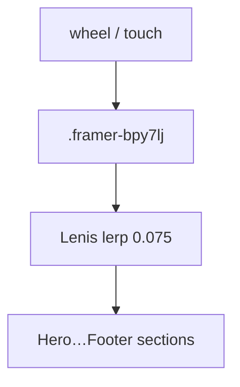

# NOVIA STUDIO — React Portfolio

Standalone React 18 build of the NOVIA STUDIO portfolio with the original
Framer visual composition preserved. Capsule docs:
[../README.md](../README.md), [../docs/quickstart.md](../docs/quickstart.md).

## Run

```bash
node server.js
```

Open:

```text
http://127.0.0.1:4173
```

No install step is required. React, ReactDOM, and Lenis are bundled locally
in `vendor/`.

## Scroll architecture

The preserved Framer layout uses `.framer-bpy7lj` (Content-Wrapper) as its
100vh overflow scroller. Lenis **1.3.26** is attached to that element
(`wrapper` + first child as `content`), not to `window`. That is the
difference from the earlier broken attempt: window-level Lenis ate wheel
events while the nested wrapper still owned overflow.

Feel: `lerp: 0.06`, `wheelMultiplier: 0.9`, `autoRaf: true`, anchor offset
`24px` with `duration: 1.1`. Tuned between under-smoothed (`0.075`) and too-slow
(`0.04`). `prefers-reduced-motion: reduce` disables smoothing. If Lenis is
missing, native overflow and `scrollIntoView` remain.

GSAP is an optional visual-only enhancement and never intercepts scrolling.



## Structure

- `src/app.js` — React mount, Lenis, optional GSAP visual motion
- `src/portfolio-markup.js` — preserved portfolio markup and content
- `styles/framer.css` — original visual styling
- `styles/lenis.css` — official Lenis 1.3.26 stylesheet
- `styles/novia.css` — scoped text/layout and Lenis coexistence
- `assets/` — original visual assets plus Novia portfolio work
- `vendor/` — local React runtime and Lenis
- `server.js` — minimal local static server
